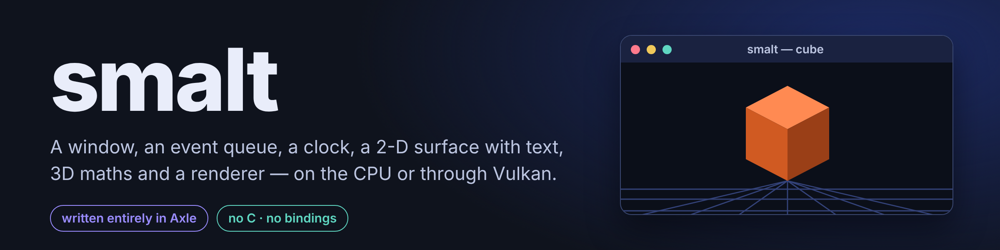
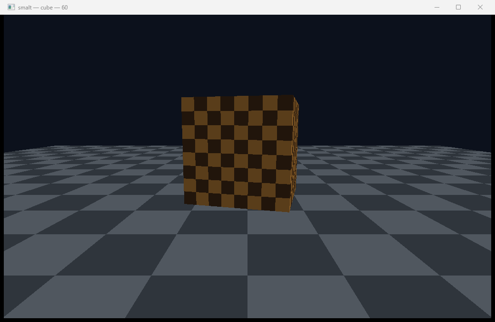
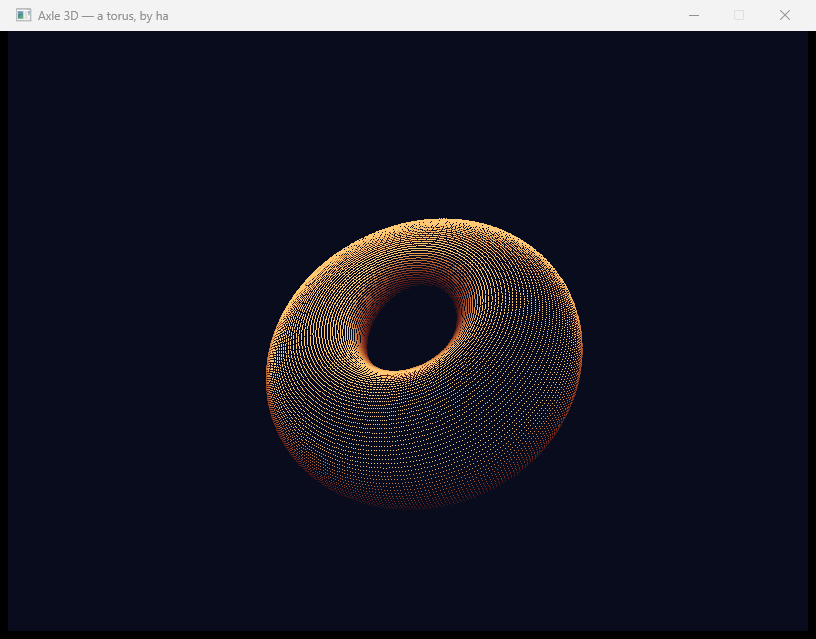
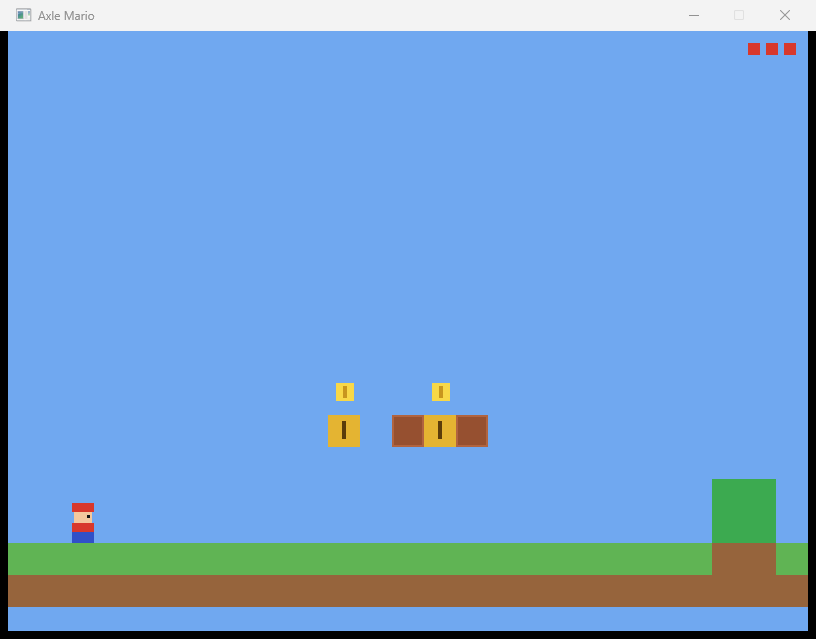
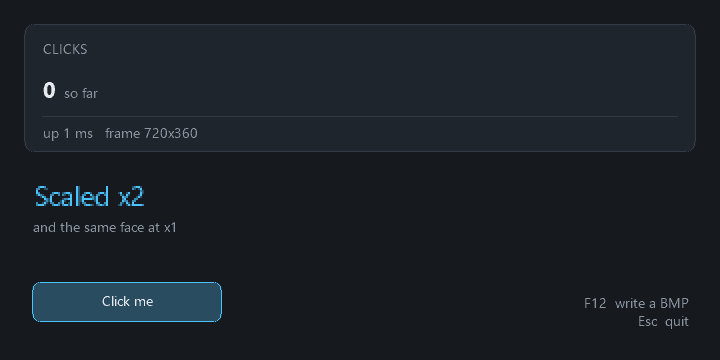
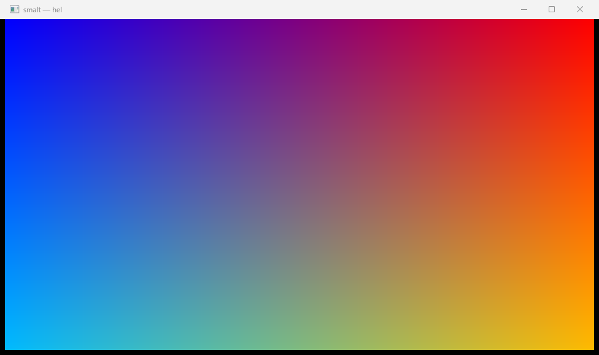
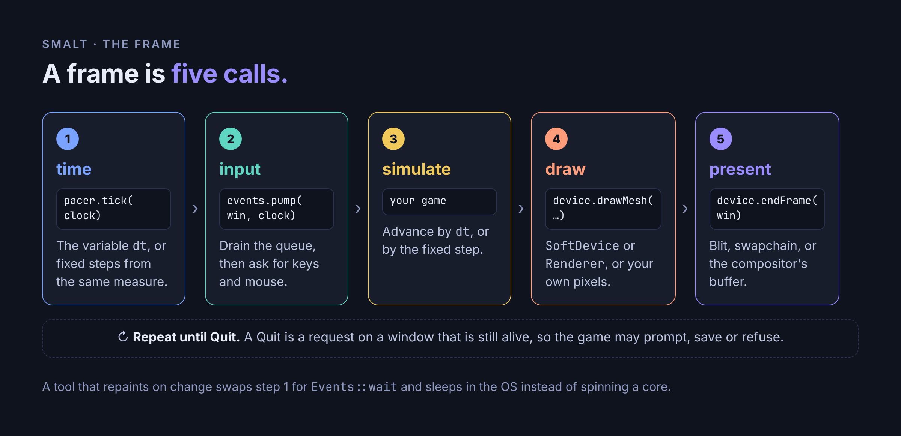
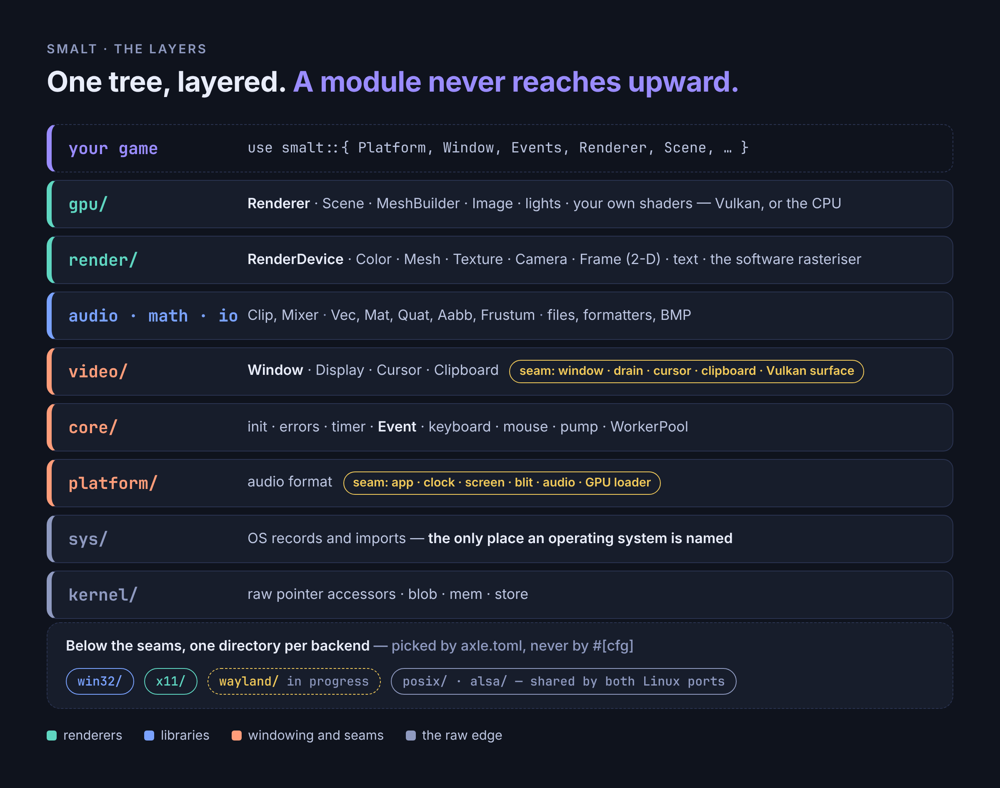
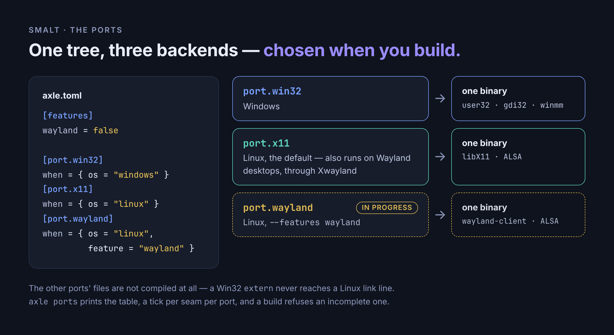
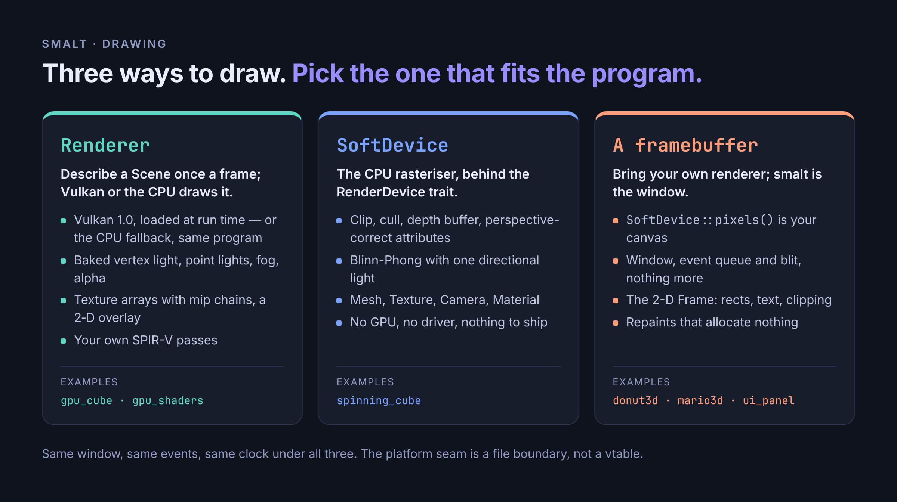

<div align="center">



<br>

<p align="center">
  <a href="https://axle-lang.dev"></a>
  <a href="https://axle-lang.dev"></a>
</p>
<p align="center">
  
  
  
  
  
</p>

<sub><a href="#-at-a-glance">At a glance</a> · <a href="#-highlights">Highlights</a> · <a href="#-quick-start">Quick start</a> · <a href="#-whats-in-the-box">What's in the box</a> · <a href="#-examples">Examples</a> · <a href="#%EF%B8%8F-architecture">Architecture</a> · <a href="#-status">Status</a> · <a href="https://axle-lang.dev">Axle ↗</a></sub>

</div>

---

**Not a binding.** There is no DLL to copy, no package prefix to find, no `[link]` section to fill in. smalt speaks Win32 and X11 itself (Wayland is in progress), rasterises every triangle on the CPU — and when the machine has a Vulkan driver, loads it at run time and draws on the GPU instead, with the same program. See [`doc/GPU.md`](doc/GPU.md).



<div align="center"><em>The 3D pipeline: a textured cube over a perspective-correct tiled floor, Blinn-Phong lit and depth-tested — every triangle rasterised on the CPU, in a window Axle opened itself.</em></div>

<table>
<tr>
<td width="25%"></td>
<td width="25%"></td>
<td width="25%"></td>
<td width="25%"></td>
</tr>
<tr>
<td align="center"><em><code>donut3d</code><br>its own renderer</em></td>
<td align="center"><em><code>mario3d</code><br>framebuffer only</em></td>
<td align="center"><em><code>ui_panel</code><br>2-D surface, on X11</em></td>
<td align="center"><em><code>hello_window</code><br>the smallest one</em></td>
</tr>
</table>

> **smalt** *(n.)* — a deep blue pigment made by grinding cobalt glass to powder.
> Glass, ground down until it is something you can paint with. That is the whole library:
> a window, taken apart into pixels you write yourself.

## 📊 At a glance

| | |
|---|---|
| **Language** | 100% [Axle](https://axle-lang.dev) — no C, no bindings, no vendored library |
| **Platforms** | Windows (Win32: `kernel32`, `user32`, `gdi32`, `winmm`) and Linux, on X11 (`X11`, `asound`, `c`) or Wayland (`wayland-client`, `asound`, `c`) — one source tree, the target picks the backend and a feature picks between the two Linux ones |
| **Scope** | What a 3D game needs: a window, input, time, sound, a 2-D surface with text, the maths, and a renderer — without gamepads yet |
| **Rendering** | `Renderer`: a scene described once per frame and drawn by Vulkan 1.0 if the machine has a loader, by the CPU rasteriser if not — one program, both. The CPU path is a full software pipeline (near-plane clipping, culling, depth buffer, perspective-correct interpolation, Blinn-Phong); the GPU path adds vertex-colour baked light, point lights, fog, alpha test and blending, texture arrays with mip chains (sRGB ones averaged in linear light), a program's own SPIR-V shaders and full-screen passes, and frame read-back; both have a 2-D overlay. See [`doc/GPU.md`](doc/GPU.md) for what is checked and what is not |
| **Known limits** | Every one of them, with what it would take to lift it: [`LIMITATIONS.md`](LIMITATIONS.md) |

## ✨ Highlights

### 🪟 Windows and platforms

- **A real window, not a canvas** — `RegisterClassExW` with our own window procedure on Windows, `XCreateSimpleWindow` on X11, a `wl_surface` given a role by `xdg_toplevel` on Wayland. A close is a *request* the game may refuse, not an obituary.
- **Three ports, one API** — Win32 and X11 build and run today, Wayland is in progress. The target and a feature pick the port when you build; the other backends' files are not in the binary at all. See [Architecture](#%EF%B8%8F-architecture).
- **A protocol with no library to call it** *(Wayland port, in progress)* — `libwayland-client` exports tables and no request functions, and an extension's tables exist in no library, so smalt builds xdg-shell's and xdg-decoration's itself at startup. [Details →](doc/INTERNALS.md#the-wayland-backend)
- **Desktop basics** — system clipboard text, system cursors, relative mouse mode.
- **Nothing to ship** — the binary runs on a stock Windows box, or against the `libX11` and `libasound` any Linux desktop already has.

### 🎮 Input and time

- **A queue decoupled from the OS pump** — every event carries the same `kind` / `timestamp` prefix, and scancodes are physical positions: `Scancode::W` is the key above `Scancode::S` on AZERTY too.
- **Both halves of a frame loop** — `FramePacer` hands out a variable `dt` *and* fixed simulation steps (`steps()` / `alpha()`) from one measurement, so the simulation and the frame cannot drift into two timelines.
- **A loop that actually sleeps** — `Events::wait` blocks in the OS until something arrives: a tool that repaints on change costs no measurable CPU between changes.

### 🎨 Rendering

- **A complete software 3D pipeline** — near-plane clipping, culling, a reciprocal depth buffer, perspective-correct attributes, Blinn-Phong with one directional light. Nothing to install.
- **A GPU path that is not a binding** — `Renderer` loads Vulkan with `dlopen` / `LoadLibraryExW` (no `-lvulkan`, no SDK), draws a `Scene` you described, and falls back to the CPU on a machine with no driver. A game never sees an instance, a queue or a barrier.
- **Your own shading** — a program brings SPIR-V: mesh stages, a background, full-screen passes over the frame, and can read a frame back. [Design →](doc/GPU.md)
- **Light a voxel game can use** — baked per-vertex light, point lights, fog, alpha test and blending, texture arrays with mip chains (sRGB ones averaged in linear light), and a 2-D overlay.

### 🖼️ 2-D and text

- **A surface with a clip, so a program does not have to bring one** — `Surface::frame()` hands back a `Frame`; `clipped()` answers a *copy*, so there is no `unclip` to forget and nesting can only narrow.
- **Text without carrying a font** — two faces baked in, 2 bits of coverage per pixel so they are anti-aliased against whatever they land on.
- **Figures straight to bytes** — `Fmt` and `Scratch` write a count, a percentage, a byte size or a clock into a block you own: a repaint allocates nothing at all.

### 📐 Maths and sound

- **The maths a game needs** — `Vec2` `Vec3` `Vec4` `Mat4` `Quat` `Aabb` `Plane` `Frustum`: value structs, all tested by a headless example.
- **Sound with no callback** — every low-latency audio API wants to call *you*, and Axle cannot hand out a function address. `waveOut` with `CALLBACK_NULL` reports a finished block as a flag you poll; ALSA's `snd_pcm_avail_update` answers the same question. A 32-voice mixer with positional sound sits on top.

### 🧯 Safety and portability

- **Failure and teardown are the compiler's business** — a subsystem that cannot start raises `PlatformError` from its constructor, so there is no half-built object to test; every handle-holding class is `Closeable`, and dropping one without `close()` is **E0511**, not a leak found later.
- **`unsafe` at the OS edge only** — raw pointers live in `kernel/raw`, the platform backends and the BMP decoder; nothing above them contains one.
- **The architecture is enforced** — `tools/check_seam.sh` fails the build when an OS import appears outside a port directory, and `axle ports` refuses a port that owes a seam. Both have self-tests that plant the violation they look for.

## 🚀 Quick start

```toml
# your-game/axle.toml
[package]
name = "your-game"

[dependencies]
smalt = { path = "../smalt" }
```

```rs
use smalt::{Platform, PlatformError, WindowDesc, Events, EventKind, Clock, FramePacer, SoftDevice, Camera, Color};

// `main` is the only place errors stop: a function declared `! PlatformError`
// lets a raise from the constructor or `open` leave it without any ceremony.
fn main() : i32 {
    try {
        return run();
    } catch e : PlatformError {
        println(e.message);
        return 1;
    }
}

fn run() : i32 ! PlatformError {
    // --- Open the platform, and the window on it ---------------------------
    // Every handle here is `Closeable`, so the compiler refuses the path that
    // forgets one. `defer` runs on the way out, including the error way out.
    let platform = new Platform();
    defer platform.close();

    let win = platform.open(
        WindowDesc { title: "game", w: 1280, h: 720, resizable: true }
    );
    defer win.close();

    // --- The three things a frame is made of -------------------------------
    let clock = new Clock();          // one measurement, shared by pacer and events
    defer clock.close();

    let events = new Events();        // input queue, drained once per frame
    defer events.close();

    let device = new SoftDevice(1280, 720);   // the software 3-D pipeline
    defer device.close();

    let camera = new Camera();

    // --- The loop ----------------------------------------------------------
    let pacer = new FramePacer(60);
    let mut running = true;
    while (running) {
        // 1. time: `dt` is the variable span since the last tick
        let dt = pacer.tick(clock);

        // 2. input: pump the OS queue, then drain it
        events.pump(win, clock);
        while (events.hasNext()) {
            let e = events.next();
            match e.kind {
                EventKind::Quit => { running = false; }
                _ => {}
            }
        }

        // 3. draw: camera, clear, geometry, present
        //    (`mesh` / `model` / `texture` / `material` are your own assets)
        device.setCamera(camera);
        device.beginFrame(Color::black());
        device.drawMesh(mesh, model, texture, material);
        device.endFrame(win);
    }

    return 0;
}
```

That is the whole setup. No DLL beside the binary, no `[link]` section — `gdi32` and `winmm` are named by the `extern "C" from "…"` blocks that import from them, so a consumer links what it uses without being told twice.

### Prerequisite

Only the Axle compiler, **v0.20.0 or newer**:

```bash
axle --version      # must print 0.20.0 or higher
```

0.20 is a floor, not a preference. It spells annotations as values —
`@layout(packed)`, `@link(symbol = "…")` — and an array is made with
`new T[n]` (there is no `malloc<T>`); a shared object is `share new X(…)`;
memory released by hand is the statement `drop value;` (`free` is gone, and
`drop` is a keyword, so a field that mirrors a C name is spelled `drop_`).
`let mut` is for a binding that is itself assigned (`x = …`, `x[i] = …`,
`x.field = …`) and nowhere else: a plain `let` is enough to call a `mut self`
method or to pass a struct to a `mut` parameter. An older compiler does not
know these spellings, so there is no version that builds both.

0.21 builds every example too, with one rule more: a parameter handed on to
a `mut` parameter must be `mut` itself (E0283), since a read-only parameter
is a copy its own caller never sees. smalt is written to it; a `mut`
parameter is a 0.20 spelling as well, so the floor stays 0.20.

<details>
<summary><b>Missing or older? Install / upgrade Axle →</b></summary>

<br>

- **Windows** — install the x64 `.msi` from the `v0.20.0` (or newer) release; it puts `axle.exe` in `C:\Program Files (x86)\Axle\` and on your `PATH`.
- **Other platforms** — see [axle-lang.dev](https://axle-lang.dev).

On Linux, the X11 port needs `libx11-dev` and `libasound2-dev`; the
Wayland one needs `libwayland-dev` in their place. Both are the `-dev`
package only for the linker's sake — the produced binary runs against
the shared library the desktop already has.

</details>



## 🕹️ Examples

```bash
cd examples/spinning_cube && axle build -O 2 && ./target/spinning_cube.exe
```

A textured cube on a tiled floor, lit and depth-tested, at a locked 60 fps. `WASD` to move, `Tab` to capture the mouse and look around, `Escape` to quit.

**The examples come in three kinds, and the split is the point.**

| Example | What it drives |
|---|---|
| `spinning_cube` | the full 3D pipeline — camera, meshes, textures, lights, the rasteriser |
| `gpu_cube` | the same through `Renderer` — a scene, baked vertex light, a lamp, fog, glass, a 2-D overlay — on a GPU or on the CPU fallback (`--software`, `--gpu`); R releases and re-uploads the crate, a lost GPU carries on on the CPU, and `--smoke` draws 120 frames and checks the teardown |
| `gpu_shaders` | a program's own shading through `Renderer` — a background whose texture is rewritten every frame, a mesh shader, two full-screen passes — and checks the frame it reads back; exits 0 with nothing to check on a machine with no GPU |
| `ui_panel` | the 2-D surface — a clipped card, rounded corners, anti-aliased text, a live figure, `Events::wait`, and `F12` to a BMP |
| `donut3d` | **its own** renderer, over `SoftDevice::pixels()` — smalt is only the window |
| `mario3d` | same: a game that already had a renderer and just wanted a framebuffer |
| `hello_window` | the smallest thing that opens and closes cleanly |
| `self_check` | asserts the maths, the frame pacer, the clip, the glyph metrics, the formatters and the containers — runs headless, no display needed |
| `gpu_check` | asserts what surrounds the driver — the mesh builder's vertex layout, handles, images and their mip chains, the scene's ordering, culling and passes, the shader blocks' byte offsets, `Mat4::inverse`, the Vulkan record layouts — headless, no GPU needed |
| `audio_check` | asserts the WAV decode and the device's block cycle |
| `proc_check` | asserts the window procedure — headless, under a second |

A program that already has a renderer should not have to adopt one to get a window. smalt stays a framebuffer underneath, and says so by shipping two programs that use it that way.

`ui_panel --snap` draws one frame, writes `ui_panel.bmp` and quits, so the layout can be checked without anyone standing over the machine at the right moment.

## 📦 What's in the box

| Area | What you use |
|---|---|
| **Platform** | `Platform`, `Window` — `platform.open(WindowDesc { … })` or `createWindow(title, w, h, flags)`; flags such as `Window::RESIZABLE`; `win.close()`. A failure is raised where it happens: `catch e : PlatformError` → `e.message` |
| **Events** | `events.pump(win, clock)`, `hasNext()` / `next()`, `wait(win, clock, timeoutMs)`; `Event` (one flat struct) + `EventKind`; `isKeyDown(Scancode::W)`, `mouseX()` / `mouseY()` / `isButtonDown`, `setRelativeMouse(true)` |
| **Desktop** | `win.clipboardText()` / `setClipboardText(text)` (text only), `win.setCursor(CursorShape::…)` |
| **Time** | `Clock` — `ticks`, `counter`, `frequency`, `delay`, `delayUntil`; `FramePacer` — `tick(clock)` sleeps and answers `dt`, `steps()` / `alpha()` for a fixed timestep |
| **Files and images** | `Bmp::load` / `Bmp::read` (raises `IOException`) / `Bmp::write`, `AssetFile::readAll` |
| **2-D surface** | `Rect`, `Surface`, `Frame` — `fillRect`, `fillRound`, `border`, `shade`, `ring`, `spark`, `clipped`; `Damage` + `presentRegion` for partial updates |
| **Text** | `BitmapFont::baked(Face::Ui)` (`draw` for a label, `drawBytes` for a figure, `fromTables` for a face of your own); `Fmt` / `Scratch`; `BytePool` / `SlotIndex` |
| **Maths** | `Vec2` `Vec3` `Vec4` `Mat4` `Quat` `Aabb` `Plane` `Frustum` |
| **3D on the CPU** | `SoftDevice` behind `RenderDevice`; `Mesh` `Primitives` `Texture` `Camera` `Material` `DirectionalLight`; `beginFrame` … `endFrame` |
| **3D on a GPU** | `Renderer` (Vulkan or the CPU, behind the `GpuBackend` trait); `Scene` `MeshBuilder` `Image` `PointLight` `Fog`; `Renderer::render` is the whole pass |
| **Audio** | `new Mixer()` opens the default output; `Clip::load(path)`; `mixer.pump()` — call it far more often than a block lasts; `playRandPos` + `setListener` for attenuated positional sound |

**Left out on purpose:** callback APIs (timers, event filters, watchers) — where other libraries call back, smalt polls.

## 🏛️ Architecture

<p align="center"></p>

**A module never reaches upward.** The operating system lives under `src/*/<os>/` and nowhere else, and not one `use` in the portable half names a platform — `tools/check_seam.sh` is that sentence, enforced.

### One tree, three backends

<p align="center"></p>

There is no `#[cfg]` in Axle, and there is not one here either. A crate declares its **ports** in `axle.toml` — a condition and the directories that carry it — and a module path resolves to `<path>.axle` when a capability has one implementation, or to a file in the *active* port's directory when it has one per backend:

```rs
use crate::platform::sys_clock::SysClock;   // core/timer.axle — win32, x11 or wayland, by the build
```

Exactly one port is active for any target. **X11 or Wayland is chosen when you build, not when you run**, and X11 is the default on purpose: Xwayland means an X11 binary runs on every Wayland desktop, while a Wayland binary does not run on an X11-only session.

```bash
axle build --features wayland          # the root crate
```

```toml
# a game asking the library it uses
smalt = { path = "../smalt", features = ["wayland"] }
```

The seams, what each costs on each side, and why the platform seam is a file boundary rather than a vtable: [`doc/INTERNALS.md`](doc/INTERNALS.md#ports-in-depth).

**Objects and values.** What has identity and a lifetime is a class: `Platform`, `Window`, `Events`, `Clock`, `SoftDevice`, `Mesh`, `Texture`, `Camera`, `RenderTarget`, `Blob`. What is data is a value struct: `Vec3`, `Mat4`, `Quat`, `Color`, `Vertex`, `Material`, `Event`, `Rect`, `Aabb`. Free functions appear only in the raw kernel, where the carrier is context rather than subject.

### Three ways to draw

<p align="center"></p>

A program that already has a renderer should not have to adopt one to get a window: smalt stays a framebuffer underneath, and ships two programs (`donut3d`, `mario3d`) that use it that way. The CPU rasteriser is described in [`doc/INTERNALS.md`](doc/INTERNALS.md#the-rendering-pipeline); the GPU path — `Renderer`, `Scene`, the Vulkan backend, and how a CPU-rasterised game moves onto it — in [`doc/GPU.md`](doc/GPU.md).

## 🚦 Status

| | Windows (Win32) | Linux (X11) | Linux (Wayland) |
|---|---|---|---|
| Builds | ✅ every example (Axle 0.20, 0.21) | ✅ every example (Axle 0.20) | ❌ the port does not compile with the current compiler yet |
| Headless checks (`self_check`, `gpu_check`) | ✅ | ✅ | — |
| A window opens and draws | ✅ | ✅ `ui_panel --snap` drew a frame and `spinning_cube` ran, both under Xvfb | — |
| Vulkan GPU path | ✅ one discrete GPU | not run | not run |
| Audio | ✅ | builds | — |

Gamepads, touch, dialogs, IME, drag-and-drop, clipboard formats other than text, several monitors and macOS are not covered. On the GPU side only Vulkan 1.0 exists, with no shadows, MSAA or instancing. **Everything smalt does not do, and how far each claim has been verified, is written down in one place: [`LIMITATIONS.md`](LIMITATIONS.md).**

## 📚 Documentation

| | |
|---|---|
| [`doc/INTERNALS.md`](doc/INTERNALS.md) | Ports and seams in depth, the Win32 window procedure, the Wayland backend, the 2-D surface, the sleeping event loop, the rasteriser, notes for extending |
| [`doc/GPU.md`](doc/GPU.md) | The `Renderer`: design, what is checked, what is not |
| [`LIMITATIONS.md`](LIMITATIONS.md) | What smalt does not do, what the language costs, what is verified |

## 📄 License

MIT.
