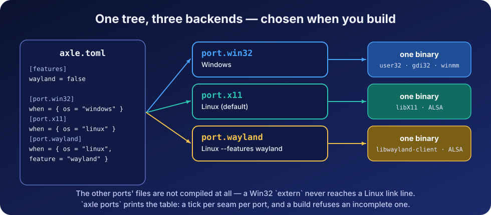

# How smalt works inside

The README is the tour; this is the machinery. Each section is independent.

- [Ports in depth](#ports-in-depth) · [The eleven seams](#the-eleven-seams) · [Objects and values](#objects-and-values)
- [The window procedure](#the-window-procedure) · [The Wayland backend](#the-wayland-backend)
- [The 2-D surface](#the-2-d-surface) · [The event loop that sleeps](#the-event-loop-that-sleeps)
- [The rendering pipeline](#the-rendering-pipeline) · [Notes for anyone extending this](#notes-for-anyone-extending-this)



## Ports in depth

There is no `#[cfg]` in Axle,
and there is not one here either. A crate declares its **ports** in
`axle.toml` — one condition, and the directories that carry it:

```toml
[features]
wayland = false

[port.win32]   when = { os = "windows" }                       dirs = ["win32"]
[port.x11]     when = { os = "linux" }                         dirs = ["x11", "posix", "alsa"]
[port.wayland] when = { os = "linux", feature = "wayland" }    dirs = ["wayland", "posix", "alsa"]
```

A module path then resolves to `<path>.axle` when a capability has one
implementation, and to a file in one of the *active* port's directories
when it has one per backend — so a portable file writes

```rs
use crate::platform::sys_clock::SysClock;   // core/timer.axle
```

and gets `platform/win32/`, `platform/x11/` or `platform/wayland/`
depending on the build. The other files are not compiled at all, which is
why a Win32 `extern "C" from "gdi32"` never reaches a Linux link line.

**Exactly one port is active for any target**, which is what keeps the
resolution a lookup rather than a search. `{ os = "linux", feature =
"wayland" }` is *narrower* than `{ os = "linux" }`, so it wins when the
feature is on and X11 answers when it is off; two conditions that
overlapped with neither narrower would be refused rather than settled by
declaration order. Three more shapes are refused rather than guessed: a
path satisfied by *both* a portable file and the active port, two
directories of one port answering the same path, and a seam one port
implements while another does not — the last names the file to write, and
`axle ports` prints the whole table with a tick per seam per port.

One directory can belong to several ports, and `posix/` does: both Linux
ports name it, the Windows one does not, so it is exactly where the two
of them keep what they share.

**X11 or Wayland is chosen when you build, not when you run.** There is
no probe of `$WAYLAND_DISPLAY` at startup and no fallback: the port
system compiles *one* backend, and the other's files are not in the
binary at all. That is the same decision as the seam being a file
boundary rather than a vtable — stated once here because it is the first
thing a Linux user asks.

The default is X11, and deliberately: Xwayland means an X11 binary runs
on every Wayland desktop, while a Wayland binary does not run on an
X11-only session. So the X11 build is the one that runs everywhere, and
the Wayland one is what to build when a session has no Xwayland, or when
X11's own limits are the problem.

Switching is a flag or a line, whichever fits:

```bash
axle build --features wayland          # the root crate
```

```toml
# a game asking the library it uses
smalt = { path = "../smalt", features = ["wayland"] }
```

The flag reaches the root crate; the manifest line is how a dependent
asks, because a feature is declared in one manifest and the edge that
names the crate is the only place that knows which one is meant. Both
only ever *enable* — nothing takes a feature away from a crate that
turned it on.

Choosing at *run time* is a larger question. It would mean both backends
in one binary behind a dispatch — the `RenderDevice` shape applied to the
platform seam — which is what the file boundary was chosen against, and
which only earns its keep if the X11 build's reach through Xwayland ever
stops being enough.

The invariant that makes it hold is one sentence: **the operating system
lives under `src/*/<os>/` and nowhere else, and not one `use` in the
portable half names a platform.** `tools/check_seam.sh` is that sentence
enforced — three rules, each with a `--selftest` that plants the
violation it is for and fails if the check passes on it.

`platform/` sits below `core/` on purpose. A seam that lived beside the
code it serves would be reachable from it, and the first shortcut past it
would go unnoticed; from underneath it can only be called down into. That
is also why `sys_blit` takes a bare `i32[]` rather than a `RenderTarget`,
and why the drawable a window hands the blit lives under `platform/` and
not beside the window that fills it — `x_surface`, the
`(Display *, Window, GC)` triple X11 needs where Win32 has a single
`HDC`, and `wl_drawable`, which holds more than either because Wayland
has no server-side drawable at all.

## The eleven seams

(`sys_gpu_loader` and `sys_vk_surface` are the two a GPU adds; `sys_clipboard` is the last.)

| Seam | Win32 | X11 | Wayland |
|---|---|---|---|
| `sys_app` | `GetModuleHandleW`, `RegisterClassExW`, `timeBeginPeriod` | `XOpenDisplay` / `XCloseDisplay`, detectable auto-repeat | the token is a *record*: a connection answers nothing until the registry is swept and each global bound |
| `sys_clock` | `QueryPerformanceCounter`, `Sleep` | `clock_gettime(CLOCK_MONOTONIC)`, `nanosleep` — shared with Wayland, in `posix/` | ⟵ the same file |
| `sys_screen` | `GetSystemMetrics` | `XDisplayWidth` / `XDisplayHeight` on a connection of its own | the first `wl_output`'s current mode — one monitor, not the bounding box of all of them |
| `sys_blit` | `StretchDIBits` — the driver scales | `XPutImage` — **no scaling blit**, so a 16.16 nearest-neighbour resample, shared with Wayland in `posix/` | a copy into whichever of **two** shared buffers the compositor is not reading, then attach / damage / commit |
| `sys_audio` | `waveOut` + `CALLBACK_NULL`, four blocks polled for `WHDR_DONE` | `snd_pcm_writei` + `snd_pcm_avail_update`, two staging blocks, `snd_pcm_recover` on an underrun | ⟵ the same ALSA file |
| `sys_window` | `HWND` + `HDC`; the latches are written by our window procedure | `Window` + `GC`; the latches are written by the drain | three objects — `wl_surface`, `xdg_surface`, `xdg_toplevel` — and a handshake: the first commit carries no buffer, it *asks* |
| `sys_drain` | `PeekMessageW` over the thread queue | `XPending` / `XNextEvent` — one stream for input *and* window notices | `poll` on the connection, then `dispatch_pending`; the events arrive as C callbacks that leave records on a ring |
| `sys_cursor` | `ClientToScreen` + `SetCursorPos`; `ShowCursor`'s balanced counter | `XWarpPointer` (window-relative); hiding is a cursor with no pixels | hiding is `set_cursor` with no surface; **there is no warp at all** — see below |
| `sys_gpu_loader` | `LoadLibraryExW` of System32's `vulkan-1.dll` + `GetProcAddress` | `dlopen("libvulkan.so.1")` + `dlsym` — shared with Wayland, in `posix/` | ⟵ the same file |
| `sys_vk_surface` | `vkCreateWin32SurfaceKHR(HINSTANCE, HWND)` | `vkCreateXlibSurfaceKHR(Display *, Window)` | `vkCreateWaylandSurfaceKHR(wl_display *, wl_surface *)` |
| `sys_clipboard` | `OpenClipboard` / `GetClipboardData` (`CF_UNICODETEXT`) | the `CLIPBOARD` selection — served from our drain when another client asks | a `wl_data_device` that reports the selection, and a `wl_data_source` we offer |

What is deliberately **not** duplicated: the PS/2 set-1 code block
(`video/scancode_set1`), which Windows reads out of `lParam` bits 16..23
and evdev numbered identically for its first eighty-eight keys; the
evdev-to-`Scancode` table above that block (`video/posix/evdev_keymap`),
which X11 reaches by taking its protocol's eight-keycode offset off and
Wayland reaches directly; the nearest-neighbour resample
(`platform/posix/blit_scale`), which neither Linux backend can do while
it blits and Windows never needs; the DIB records (`sys/dib`), a
published data format both a `.bmp` file and `StretchDIBits` carry; and
the PCM format (`platform/audio_format`), which is the seam's contract —
a backend that kept its own copy could open a device at 48 kHz while the
mixer still wrote 44.1, and nothing would fail.


## Objects and values

What has identity and a lifetime is a class: `Platform`, `Window`, `Events`, `Clock`, `SoftDevice`, `Mesh`, `Texture`, `Camera`, `RenderTarget`, `Blob`. What is data is a value struct: `Vec3`, `Mat4`, `Quat`, `Color`, `Vertex`, `Material`, `Event`, `Rect`, `Aabb`. Free functions appear only in the raw kernel, where the carrier is context rather than subject.

**Why the rendering seam is a trait and the platform seam is not.** A backend chosen at *run time* wants a vtable; here the platform is chosen at compile time, and a vtable would buy nothing but a dispatch on every window operation — so the platform seam is a *file* boundary: one file per capability per OS, each stating its contract in its header, and a port writes the files the compiler names. Rendering is the one place where a second backend is genuinely reachable at run time, so `RenderDevice` is a real trait with `SoftDevice` behind it.

## The window procedure

`RegisterClassExW` will not accept a class without an `lpfnWndProc`, and what that field wants is a *C-callable address*. An Axle function value is the fat `{ code, env }` pair — which is what lets a capturing lambda and a bare function share one call shape — and that is not an address `user32` can invoke.

`extern "C" (…) => R` is a thin function pointer: one machine word holding the function's own address, and a named `fn` degrades to it at the boundary. So `video/win32/win_proc.axle` holds a real window procedure, and the messages Windows *sends* arrive as messages:

| what | how |
|---|---|
| the window was closed | `WM_CLOSE`, **recorded not obeyed** — the game decides |
| the window was resized | `WM_SIZE`, with the size Windows sent |
| focus gained or lost | `WM_SETFOCUS` / `WM_KILLFOCUS` |
| minimised or restored | `WM_SIZE` with `SIZE_MINIMIZED` |

Input still comes from the queue, which `PeekMessageW` drains every frame: `WM_KEYDOWN`, `WM_KEYUP`, `WM_CHAR`, `WM_MOUSEMOVE`, the button messages, `WM_MOUSEWHEEL`.

**Where the state lives.** A window procedure captures nothing — it is handed a handle and three integers, and Axle has no mutable globals. The Win32 answer is the window's own user data: a block's address goes in with `SetWindowLongPtrW` at creation and comes back with `GetWindowLongPtrW` on every message. That block is an `extern "C" struct`, because two pieces of code read it at offsets each computes for itself, and it is allocated with `sizeof<WinProcState>()` so a new field cannot leave the allocation behind. `WNDCLASSEXW.lpfnWndProc` is declared as the procedure's own type — `extern "C" (ptr, u32, u64, i64) => i64` — so the class is registered by naming `windowProc`, and a procedure of the wrong shape is a diagnostic at that line instead of a stack the OS unwinds wrongly.

**What the procedure may not do.** Throw. The unwind would cross a frame `user32` owns, which has no landing pad for one — and the compiler refuses a throwing function at the boundary (**E0748**) rather than trusting the author to remember.

**What a close now means.** `DefWindowProcW` answers `WM_CLOSE` by destroying the window; the procedure records it instead. A `Quit` event is therefore a *request* arriving on a window that is still alive, which is what lets a game prompt, save, or refuse.

**Proving it without a user.** `examples/proc_check` calls `Window.selfCheckProc`, which delivers the four sent messages with `SendMessageW` — synchronous, bypassing the queue — and checks what came back. It runs headless, in under a second, and it exercises the whole chain: the class carries our address, the block is reachable from the callback, the procedure writes through the raw pointer, and the event path turns the record into events.

## The Wayland backend

> **Status.** This port does not compile with Axle 0.20.0 yet (see [`LIMITATIONS.md` §1.4](../LIMITATIONS.md#14-wayland-specifically)); what follows is the design it was written to.

Wayland gives a client less than X11 does, and most of the port is that
sentence made concrete.

**There are no request functions.** `libwayland-client` exports the core
protocol's twenty-four `wl_interface` tables and the proxy machinery, and
nothing else: `wl_surface_commit` and its hundreds of siblings are
`static inline` in the generated headers, each one call to
`wl_proxy_marshal_flags` with an opcode. That call is variadic, so this
port uses its array twin and fills a block of eight-byte slots — which is
what a `union wl_argument` is.

**An extension's tables exist in no library.** They are generated per
project by `wayland-scanner`, into C. So `sys/wayland/xdg_shell` and
`sys/wayland/xdg_decoration` build theirs at startup out of the same
three fields the generator emits — a name, a signature, and the
interfaces each argument names — and the core ones arrive through
`dlsym`, because they are *data* and Axle imports functions. Version 1 on
purpose: the library dispatches an incoming event by using its opcode as
an index into the listener, so an event table shorter than what the
compositor may send reads past the end of a struct.

**A window is three objects and a handshake.** A `wl_surface` is a
rectangle of pixels with no meaning; `xdg_surface` gives it a role's
protocol; `xdg_toplevel` is the role. The first commit carries *no*
buffer — it asks — and the compositor answers with a `configure` the
client must acknowledge before anything it draws is shown.

**Two buffers, because one is a race.** A committed `wl_buffer` belongs
to the compositor until its `release` event says otherwise, so writing
the next frame into the same pages is a tear. `wl_drawable` holds a pair
in one `memfd` pool and writes into whichever is free; a frame that
arrives when neither is gets dropped, which is a frame the compositor was
never going to show.

**A callback cannot reach the queue.** It is C calling us with one
`void *`, and an `EventQueue` is an Axle object with no address to pass.
So the seat's callbacks write records into a ring on the window's state
block, and the drain — Axle code, holding the queue — reads them out.
The same shape the Win32 window procedure needs, reached the other way
round.

**What the protocol refuses, and what smalt does about it.**

| | |
|---|---|
| **No pointer warping** | By design: the compositor owns the input device. A mouse-look game wants `zwp_pointer_constraints_v1` + `zwp_relative_pointer_v1`, which are further extensions with further tables to build. `SysCursor::recentre` does nothing and says so. |
| **No decorations** | A toplevel is the client's pixels, full stop. `xdg-decoration` is asked for where the compositor offers it, and where it does not the window has no frame — that is the desktop's answer, not a failed call. |
| **No window placement, no window position** | Neither can be asked for nor read. |
| **No event injection** | There is no `XSendEvent` here, so `selfCheck` proves the two things a client *can* provoke — a `wl_display.sync` answered into a listener of ours, and the `xdg_surface.configure` that came back through the hand-built table — and claims nothing about the focus edges and the close, which only a person can cause. |
| **No key repeat, no text yet** | A compositor sends no repeats: `repeat_info` asks the *client* to make them. And the character a key produces needs the keymap the compositor sends, which needs `xkbcommon`. Both are additions, not fixes; X11 gets the first from the server and the second from `XLookupString`. |

## The 2-D surface

`render/frame.axle` is the layer three programs built on smalt each wrote for themselves before it existed — a voxel game, a task manager, a network audit. Two of the three ended up with the same six hundred lines of glyph table, re-rasterised, already drifting apart. Four things carry it:

- **A `Frame` is a view, not an owner.** It carries the *address* of a plane somebody else holds, plus the clip in force — four words, no allocation, so `clipped()` is cheap enough to call per widget. That also settles a real crash: a getter handing back the colour buffer as an `i32[]` gives it two owners, and the second release is a fault on exit after everything has been drawn and flushed. There is no array to store, so the mistake is not writable. The price is stated once — **a `Frame` is void after its surface is resized or closed** — and `Surface::frame()` is one call, so taking it at the top of every repaint is both the cheap shape and the correct one.

- **`clipped()` answers a copy.** No `unclip`, nothing to restore on an early return, and nesting can only narrow — a widget handed a clipped frame cannot draw outside what its parent allowed it. That is what makes a list scroll: rows are drawn at their true position, one viewport clips them, and a row crossing the edge is cut mid-pixel rather than appearing whole.

- **The bounds check is per row, not per pixel.** `plot` tests the clip, because a caller plotting one pixel usually cannot say where it lands. The span fillers intersect once and then write a run — four comparisons a row instead of four a pixel — which is why `fillRect` is the call to reach for and `plot` the one to reach for last.

- **Text has two doors, because text has two sources.** `draw` takes a `string`, which is what a label is. `drawBytes` takes an address, which is what a *figure* is: every number on a repainting surface is formatted afresh each frame, and routing those through `string` mints a few hundred allocations a second for text thrown away in the same frame. `io::fmt` writes them as bytes and this draws straight from them, so the repaint path allocates nothing at all.

Glyphs are stored at **2 bits of coverage per pixel**, so text is anti-aliased against whatever it lands on rather than punched out in one colour — at 14 px that is the difference between a UI you read and one you decipher. `drawScaled` multiplies a face by an integer and the coverage survives the multiply, so a scaled heading keeps its edges instead of turning into the staircase a 1-bit font gives you. A game whose pixel font is part of its look keeps it: `BitmapFont::fromTables` takes the same three arrays and hands back every draw method.

## The event loop that sleeps

`Events::wait(win, clock, timeoutMs)` blocks in the OS until something arrives, then pumps. It is one call per port and each one is the platform's own answer: `MsgWaitForMultipleObjects` with `QS_ALLINPUT` on Win32 — the mask covers *sent* messages too, which is where a resize, a focus change and a close arrive; `XPending`, then `XFlush`, then `poll` on `XConnectionNumber` on X11, in that order, because Xlib buffers events in user space and waiting on the socket with events in hand is a program that hangs with its input sitting in memory; and libwayland's prepare/flush/poll/read with the deadline handed to the poll in the middle of it.

Without it a program that repaints on change has to choose between spinning a core and sleeping a fixed period — which answers input that much later and still wakes a hundred times a second to find nothing. Two real tools written on smalt ended their loops with `clock.delay(8)`, and both of their headers say, in as many words, that a tool measuring the machine should not be near the top of its own list.

A frame-driven game should keep calling `pump` and pace with `FramePacer`: waiting for input in a loop that must draw the next frame anyway is a frame that arrives late.

## The rendering pipeline

`render/soft/` is a complete rasteriser: near-plane clipping, perspective divide, viewport transform, back-face culling, half-space triangle fill with a depth buffer, perspective-correct attribute interpolation, and Blinn-Phong shading with one directional light. Three details carry it:

- **Clip before dividing.** A vertex behind the camera has `w <= 0`, and in Axle a division by zero *traps* — it does not produce an infinity. Triangles are clipped against `w >= 0.0001` first, which also stops geometry behind the viewer appearing mirrored in front of it.
- **Interpolate over `w`.** Screen-space linear interpolation of a texture coordinate is wrong for any surface not parallel to the screen. Attributes are carried divided by `w` and divided back by the interpolated `1/w` per fragment — the difference between a correct floor and a 1995 warped one.
- **Depth-test before shading.** A fragment that will lose the depth test must not pay for a texture fetch and a lighting evaluation.

The depth buffer stores **reciprocal** depth and the test is *greater wins*, because only the reciprocal interpolates linearly in screen space.

That is the CPU rasteriser. The GPU path — `Renderer`, `Scene`, the Vulkan backend and how a CPU-rasterised game such as voxel-axle moves onto it — is in [`doc/GPU.md`](doc/GPU.md).

## Notes for anyone extending this

Language rules that shape the signatures here:

- **Every member sits on a visibility ladder**, fields and methods alike: unmarked means the declaring class's own, then `pub(derived)`, `pub(file)`, `pub(crate)`, `pub`. smalt writes the narrowest rung that compiles, so the marker is information: `KeyboardState::isDown` is `pub` and `KeyboardState::press` is `pub(crate)`, which says in the signature what the docs used to say in prose — the drain writes the input state and a game reads it. A seam class declares `pub(crate)` and so do its methods; an implementation helper is `pub(file)`.
- **A constant is a `static` field on the class it belongs to.** This used to read the other way round: a `static` field did not cross a crate boundary, so a published constant had to be a `pub const` with the class spelled into its name — `WINDOW_RESIZABLE` rather than `Window::RESIZABLE`. Axle 0.12.1 fixed that, one day after the commit here that wrote the old rule down. So the flags are `Window::RESIZABLE` and friends now, and the prefix is the scope it was imitating. Both forms take a literal, so a constant derived from another is a `static fn` — `AudioFormat::frameBytes()`.
- **A field's default belongs on the field.** `focusedNow : bool = true;` runs at every construction, so a constructor carries only what depends on an argument, and nine classes here have none at all.
- **Storing a parameter into a field or an array element needs `own`** (**E0513** otherwise) when the parameter is a *reference* or a value that owns a resource. A plain value struct — `Vertex`, `Vec3`, `Event` — is copied into the slot and needs no keyword.
- **An object has one owner, or a `Shared` handle.** Since 0.14 a field read out of a borrowed parameter and stored into a field (`self.store = m.store`) is **E0513** like storing `m` itself, and a field of `self` handed to a new owner is **E0765** — both used to compile and free the object twice at teardown. smalt itself never needs a second owner, but a game will — one `WorkerPool` its renderer and its sky pass both run on — and that is a `Shared<T>` (`share new WorkerPool(n)`); an array held that way is `Shared::wrap(new T[n])`.
- **`mut` is the callee's permission, not the binding's.** A plain `let` binding of a class or a struct can call a `mut self` method or be passed to a `mut` parameter; `let mut` is only for a binding that is assigned (**E0004** otherwise). A `self` method may not call a `mut self` one (**E0283**).

An annotation says what it is about in its own words: `@layout(packed)` on a record, `@link(symbol = "…")` on an import, `@float(fast)` on a function. Anything else — an old spelling, a typo, one on a site it does not concern — is an error rather than a no-op, and `tools/check_seam.sh` looks for `@link(` outside the port directories as it looks for `extern "C" from`.

One shape stays out of reach: **a payload-bearing `enum` cannot carry another payload-bearing `enum`**. It is worth stating precisely, because it is usually read as ruling out more than it does — a variant payload takes a scalar, a **payload-free** `enum`, a `string`, an owning object, a `Shared`/`Weak` handle or a dynamic array. `Scancode` and `MouseButton` are payload-free, so `Event::KeyDown(Scancode, bool)` is writable **today**. `core/event.axle` is a flat struct with a `kind` tag because that is what the two decode tables were written against, not because the language refuses the tagged union.

**Handing a `Closeable` out of a call reads as a transfer.** A getter that returned a field the object still owns — `Window::native()` did — makes the call site an owner with a release to write (**E0511**), because nothing distinguishes it from `AssetFile::readAll`, which really does hand back a fresh block. The field is exposed at `pub(crate)` instead and read as `win.sys`.

Releasing a resource is `defer`'s job wherever a function has more than one way out — `Bmp::read` has six, and one `defer data.close()` covers them all. The compiler enforces the release either way: every `Blob`, `Window`, `Platform`, `Events`, `Clock` and `SoftDevice` implements `Closeable`, so a path that drops one without closing is **E0511**.
